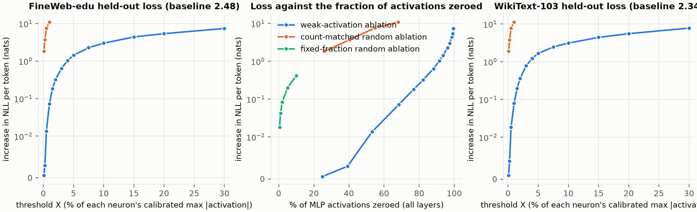
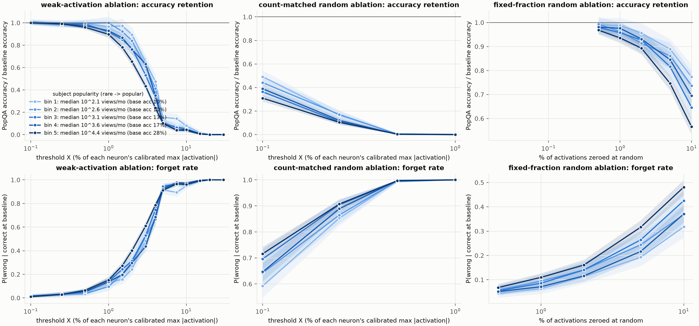
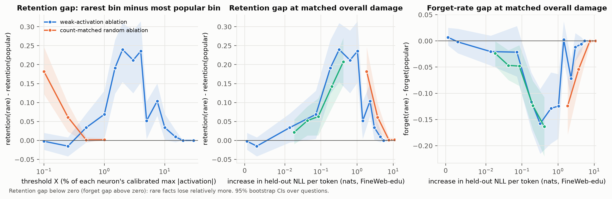
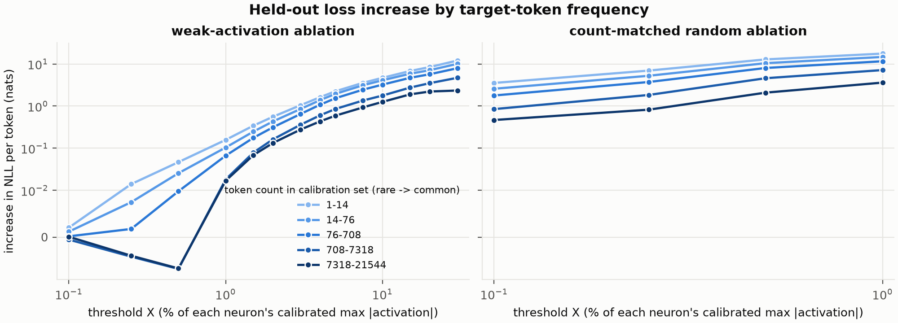

# Do weak MLP activations carry important information?

A small, reproducible test of a disputed claim. Goodfire's essay *Neural Networks Are Already Clean*
(Cammarata, Oct 2026) argues that weak neuron activations can be removed at little cost, so neurons
are not hiding superposed information there. Neel Nanda's reply predicts the opposite: weak
activations carry superposed facts, so removing them should disproportionately hurt rare, long-tail
knowledge. Neither side has run the experiment on a language model (see `docs/novelty_check.md`).

## Experiment

- **Model:** `Qwen/Qwen3-1.7B-Base`, bf16, greedy decoding. Base model so there is no chat template or
  thinking mode in the way of a plain few-shot factual-recall measurement.
- **Neuron activation:** the SwiGLU output `act(gate(x)) * up(x)`, i.e. the input to `down_proj`, in
  every one of the 28 MLP layers (6144 neurons each).
- **Calibration:** per-neuron max |activation| over 512 x 1024 tokens of FineWeb-edu, excluding
  position 0 of each sequence so first-token massive activations do not set the scale.
- **Weak-activation ablation:** zero every activation with |a| < X% of its neuron's calibrated max,
  for X in {0.1, 0.25, 0.5, 1, 1.5, 2, 3, 4, 5, 7.5, 10, 15, 20, 30}. Per-neuron maxes are heavy-tailed
  (median 17, 99th percentile 482, max 12,416 on 524k tokens), so even X = 1% already zeroes 68% of all
  activations and X >= 5% zeroes more than 93%; the realized fraction is reported everywhere.
- **Controls:** (i) count-matched random: for every (layer, token) zero the *same number* of
  activations chosen uniformly at random (two seeds; run up to X = 1%, beyond which it is already at
  chance on everything); (ii) fixed-fraction random: zero 0.5, 1, 2, 5 or 10% of activations at random
  (two seeds), which spans the same range of overall damage as the weak-activation sweep and so allows
  a comparison at matched LM loss. Together they separate "weak activations matter" from "rare facts
  are fragile to any perturbation".
- **Readouts:** (a) held-out LM loss on disjoint FineWeb-edu text and on WikiText-103 test;
  (b) PopQA accuracy (8-shot, substring match against gold aliases, as in Mallen et al. 2023), split
  into five equal-count bins of subject popularity (monthly Wikipedia page views), computed *within each
  relation type* so every bin has the same mix of question types (global bins put guessable relations
  such as occupation disproportionately in the rare bin and make baseline accuracy non-monotonic;
  `--binning global` reproduces that variant).
- **Key statistics:** per-bin accuracy retention (accuracy / baseline accuracy) and forget rate
  (P(wrong | correct at baseline)); the rare-minus-popular gap in each; 95% bootstrap CIs over
  questions. The decisive comparison is the gap under weak-activation ablation versus under the
  count-matched random control, at matched X and at matched LM-loss damage.

## Layout

```
weakabl/ablation.py   forward-pre-hooks on down_proj: calibration, threshold and random ablation
weakabl/data.py       FineWeb-edu / WikiText-103 chunks, PopQA loading, popularity bins, prompts, metric
weakabl/evaluate.py   per-token LM loss; batched greedy PopQA generation
weakabl/run.py        the sweep (checkpointed per condition; re-running resumes)
weakabl/analyze.py    metrics.csv with bootstrap CIs, and the figures
scripts/run_all.sh    full sweep;  scripts/run_extra_random.sh  fixed-fraction random control;  scripts/smoke.sh  tiny check
scripts/quick_plots.py three plain matplotlib summary plots (figures/quick)
docs/novelty_check.md literature scan and gap analysis;  docs/refs.bib  verified bibliography
results/              summary.jsonl, per-condition PopQA correctness + generations, metrics.csv
figures/              fig1-fig4
```

## Reproduce

```bash
python -m venv .venv && . .venv/bin/activate && pip install -r requirements.txt
bash scripts/smoke.sh          # ~5 min on a laptop, checks the pipeline end to end
bash scripts/run_all.sh        # 23 conditions, ~1.8 h on one A100-40GB
bash scripts/run_extra_random.sh   # 10 more, ~45 min
```

All randomness is seeded (`--seed`, `--random-seeds`); data splits are taken in stream order and
cached under `data_cache/`.

## Results

Qwen3-1.7B-Base, 14,259 PopQA questions, baseline accuracy 15.5% (10% in the rarest fifth, 28% in
the most popular fifth), baseline held-out loss 2.484 nats/token on FineWeb-edu. Full table:
`results/qwen3-1.7b-base/metrics.csv`; per-condition summaries: `summary.jsonl`.

**1. Weak activations are close to dead weight.** Zeroing the weakest quarter, two-fifths or half of
*all* MLP activations in the model changes nothing measurable; zeroing the same number at random
destroys it.

| weakest activations zeroed (X) | held-out loss increase | PopQA | same count, random |
|---|---|---|---|
| 25% (X = 0.1%) | +0.0006 nats | 15.5% | +1.84 nats, 5.8% |
| 39% (X = 0.25%) | +0.003 | 15.3% | +3.71, 1.9% |
| 53% (X = 0.5%) | +0.014 | 15.1% | +7.58, 0.1% |
| 68% (X = 1%) | +0.07 | 14.4% | +10.9, 0.0% |
| 77% (X = 1.5%) | +0.18 | 13.2% | |
| 82% (X = 2%) | +0.32 | 11.6% | |
| 88% (X = 3%) | +0.64 | 8.4% | |
| 93.5% (X = 5%) | +1.43 | 1.7% | |



**2. When damage starts, rare facts are not the first to go; popular facts are.** Under weak-activation
ablation the rarest fifth of subjects keeps a *larger* share of its baseline accuracy than the most
popular fifth at every threshold from X = 1% to 4%, and the forget rate (P(wrong | correct at
baseline)) is lower for rare subjects. The rare-minus-popular retention gap is +0.07 [95% CI 0.00,
0.13] at 68% zeroed, +0.19 [0.12, 0.27] at 77%, +0.24 [0.15, 0.31] at 82%, +0.21 [0.12, 0.29] at
88%. Nanda's prediction was the opposite sign.

| weakest zeroed | rare fifth retains | popular fifth retains | rare forget rate | popular forget rate |
|---|---|---|---|---|
| 68% | 97% | 90% | 13% | 15% |
| 77% | 97% | 78% | 16% | 27% |
| 82% | 89% | 65% | 24% | 40% |
| 88% | 65% | 43% | 48% | 61% |



**3. The ordering is a property of damage in general, not of weak activations.** Random ablation shows
the same pattern with the same magnitude at matched overall loss: fixed-fraction random at 5% of
activations (+0.20 nats) gives a retention gap of +0.14 [0.09, 0.19] versus +0.19 [0.12, 0.27] for
weak ablation at +0.18 nats; at 10% random (+0.42 nats) the gap is +0.21 [0.15, 0.27] versus +0.24
[0.15, 0.31] for weak ablation at +0.32 nats. Forget-rate gaps match the same way (-0.12 vs -0.12, and
-0.16 vs -0.16). The count-matched random control, which is at chance beyond 50% sparsity, shows the
same sign in its one informative point. So there is no interaction between "weak" and "rare": weak
ablation behaves like a much smaller random perturbation, and neither kind of perturbation singles
out long-tail facts.



**4. A token-level footnote.** Splitting the held-out loss increase by target-token frequency, weak
ablation's damage is concentrated on rare tokens: at 77% zeroed, tokens seen 1-14 times in the
calibration set lose +0.34 nats versus +0.07 for the commonest tokens, a 5x ratio, whereas random
ablation at matched loss gives +0.31 versus +0.10, a 3x ratio. Rare-token damage is about equal in the
two conditions; the difference is that weak ablation spares common tokens more (it is nearly a no-op,
and at 53% zeroed slightly *lowers* loss on the two commonest bins). This is the one place a
long-tail tilt specific to weak activations shows up, and it is at the level of next-token prediction,
not of stored facts.



**5. Amplifying the weak tail instead of zeroing it: the network does read it, linearly.** To test
Cammarata's conjecture that the network "mostly ignores weak activations," we multiplied every
sub-threshold activation by a factor s instead of zeroing it (s = 0 is the ablation above, s = 1 is the
unmodified model). If the weak regime were a dead zone, s = 2 or 4 should be as harmless as s = 0.
Instead the loss is a smooth, nearly symmetric bowl around s = 1, roughly quadratic in the size of the
perturbation: halving the tail costs about a quarter of deleting it, doubling it costs about the same as
deleting it, and quadrupling it at the 77% level is catastrophic.

| cutoff (share of activations affected) | s = 0 (zero) | s = 0.5 | s = 1 | s = 2 | s = 4 |
|---|---|---|---|---|---|
| 0.5% of max (53%) | +0.014 nats, 15.1% | +0.003, 15.3% | 0, 15.5% | +0.016, 15.2% | +0.19, 13.1% |
| 1.5% of max (77%) | +0.18, 13.2% | +0.04, 14.9% | 0, 15.5% | +0.24, 12.8% | +4.3, 0.4% |

(held-out loss increase on FineWeb-edu, PopQA accuracy; `scripts/run_scale_weak.sh`,
`figures/quick/quick4_scale_weak_tail.png`.) So weak activations are cheap to remove because they
are *small*, not because downstream layers ignore them: the readout is approximately linear, the
cost of a perturbation grows with its square, and the weak tail sits in the flat bottom of that bowl.
This also says the information the weak tail can carry is bounded by its magnitude, and that a soft
shrink (s = 0.5) is a much cheaper way to sparsify than a hard threshold.

**Interpretation.** On the question that divided the essay and its critics, the essay's side holds on
an LLM: the weak tail of SwiGLU activations can be discarded wholesale at negligible cost, and the
cost that eventually appears is not concentrated on rare facts. This does not show that superposition
is absent; it shows that whatever is superposed in weak activations is not disproportionately
long-tail factual knowledge, at least as PopQA measures it on a 1.7B model.

**Caveats.** One model, one size; PopQA's substring metric lets a damaged model get credit for short
generic answers, which helps the rare bin (baseline 10%) more than the popular bin, and the
within-relation binning removes the relation-mix confound but not this one; the "X% of max" scale is
dominated by outlier maxes, so the informative range is X < 5% and the realized sparsity is the better
axis; zero-ablation rather than mean-ablation (for near-zero activations the two coincide); 8-shot
base-model prompting, greedy decoding.

**Compute.** One A100-40GB on GCP, about 2.7 h for the 33 main conditions plus 0.5 h for the six scale-weak-tail conditions.
